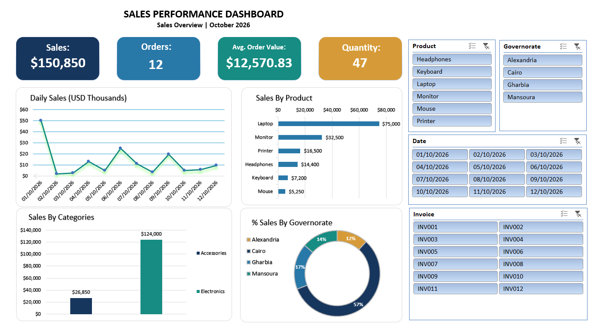

# Sales Performance Dashboard | Excel Data Analysis

An interactive Sales Performance Dashboard built using Microsoft Excel to analyze sales performance across products, categories, dates, and governorates.

## Dashboard Preview

## Project Overview

This project focuses on transforming raw sales data into an interactive dashboard that provides a clear overview of sales performance and key business metrics.

The dashboard allows users to explore sales data through interactive slicers and dynamic visualizations.

## Key Performance Indicators (KPIs)

| KPI | Value |
|---|---:|
| Total Sales | $150,850 |
| Total Invoices | 12 |
| Average Invoice Value | $12,570.83 |
| Total Quantity Sold | 47 |

## Dashboard Components

### Visualizations
- Daily Sales Trend
- Sales by Product
- Sales by Category
- Sales Distribution by Governorate

### Interactive Filters
- Product
- Governorate
- Date
- Invoice

The four slicers provide interactive filtering across the dashboard charts.

## Tools & Techniques

- Microsoft Excel
- Excel Tables
- Pivot Tables
- Pivot Charts
- Interactive Slicers
- KPI Cards
- GETPIVOTDATA
- IFERROR
- SUM, COUNTA, AVERAGE
- Data Analysis & Visualization

## Workbook Structure

| Worksheet | Description |
|---|---|
| Sales Data | Raw sales records |
| KPIs | Key performance indicators |
| Pivot Table | Supporting Pivot Tables and analysis |
| DashBoard | Interactive dashboard and visualizations |

## Project Files

- `Excel Sales Dashboard.xlsx` – Complete Excel workbook.
- `images/Sales-Dashboard.png` – Dashboard preview.

## Dataset Information

This project uses sample sales data created for educational and practical purposes. It does not represent actual company transactions or confidential business information.

## Project Objective

To develop practical Excel skills in data organization, analysis, reporting, and interactive dashboard creation.

---

**Created by Omar Nwear**  
Accounting Graduate | Excel & Data Analysis Enthusiast
